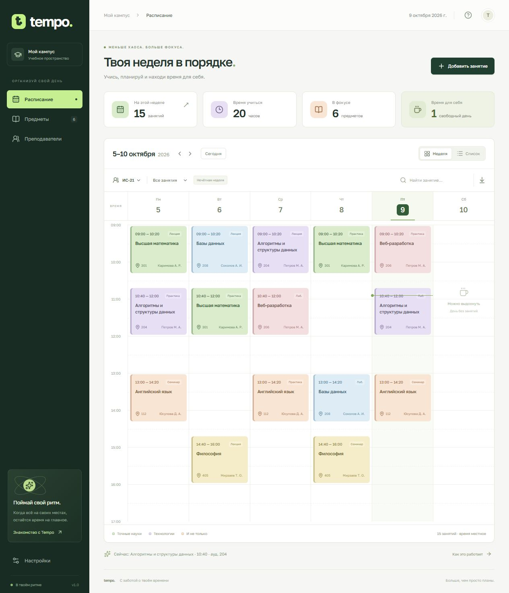

# Tempo

**Твой учебный ритм.** Аккуратное пространство, в котором удобно планировать занятия, находить нужную аудиторию и видеть неделю целиком.

Приложение на React и TypeScript с интерфейсом на **узбекском, английском и русском**. По умолчанию выбран узбекский; язык переключается в шапке и сохраняется в браузере. Публикуется на GitHub Pages; вход, роли и общее расписание работают через Supabase. Для входа и загрузки данных требуется интернет.

Проект подготовлен для предмета **Loyihalarni boshqarish**. Преподаватели: **Xusainov Sh. M.** и **Yuldashov O. E.** Реальные имена сверены с официальными страницами UrDU; предметы и их преподаватели добавлены по исходному заданию. [Источники и точность данных](docs/SOURCES.md).

**[Открыть Tempo →](https://khujamov05.github.io/tempo-campus/)**

Автор проекта: **Khujamov E.**



## Возможности

- Вход по email и паролю. Студент видит всё расписание выбранной группы; преподаватель сначала видит свои пары из всех групп.
- Администратор редактирует расписание, публикует изменения в общую базу и назначает роли существующим аккаунтам.
- Ограничения прав проверяются в базе данных; защита от перезаписи чужих изменений при одновременной работе.

- Недельная таблица из шести строк по парам: номер и время в левом столбце, предмет, аудитория и преподаватель — в карточке. При горизонтальной прокрутке левый столбец остаётся виден.
- Список занятий с отдельным столбцом времени, переход между неделями и возврат к текущей.
- Быстрое добавление занятия нажатием на пустую ячейку нужного дня и пары.
- Несколько учебных групп, справочники предметов и преподавателей; добавление новых записей.
- Несколько преподавателей одного предмета и выбор ответственного преподавателя каждого занятия.
- Добавление, редактирование и удаление занятий с возможностью отменить удаление.
- Выбор одной из шести 80-минутных пар одним нажатием, с автоматическим временем окончания.
- Повторение каждую неделю, по чётным или нечётным ISO-неделям.
- Проверка пересечений по группе, аудитории и преподавателю, включая разные предметы одного преподавателя.
- Выбор предмета из списка в расписании и справочнике, вариант «Все предметы», фильтр по формату занятия. В справочнике преподавателей сохранён текстовый поиск и переход к занятиям выбранного преподавателя.
- Количество занятий, учебные часы, число предметов и свободных учебных дней.
- Экспорт видимых занятий выбранной недели в ICS для календарных приложений.
- Резервное копирование в JSON и проверяемый импорт с подтверждением замены.
- Адаптивный интерфейс, управление с клавиатуры, поддержка уменьшенного движения.

## Запуск

**Без установки:** скачайте репозиторий через **Code → Download ZIP**, распакуйте и откройте **`standalone/index.html`** обычным браузером. Этот файл содержит JavaScript, стили и значок. Для входа и общего расписания нужен интернет. Рекомендуемый способ использования — опубликованный сайт; локальный HTML также подключается к Supabase.

Корневой `index.html` — точка входа исходного проекта для Vite; для открытия двойным щелчком используйте именно `standalone/index.html`.

**Для разработки:**

Нужен **Node.js 24+** и npm.

```sh
npm ci
npm run dev
```

Откройте адрес, который напечатает Vite (обычно `http://127.0.0.1:5173`).

```sh
npm test         # тесты бизнес-логики
npm run build   # проверка TypeScript и production-сборка
npm run preview # локальный просмотр готовой сборки
```

## Как пользоваться

Сначала войдите в выданную администратором учётную запись. Студентам и преподавателям доступны просмотр, фильтры и экспорт. Редактирование, импорт и публикация доступны администратору. У преподавателя по умолчанию выбран режим «Мои занятия — все группы»; можно переключиться на расписание отдельной группы.

После правок администратор нажимает **Опубликовать изменения**. До этого изменения остаются черновиком текущей вкладки. Другие пользователи получают новую версию после обновления страницы. При конфликте версий сохраните JSON-копию и обновите страницу перед повторным редактированием.

Ниже действия добавления и редактирования относятся к администратору.

1. Выберите группу над расписанием: **KIDT-231, KIDT-232, KIDT-233 или KIDT-234**. Названия групп и интервалы пар предоставлены автором; распределение предметов по дням и аудитории демонстрационные, преподаватели реальные. Уточните фактическое расписание перед использованием. У KIDT-233 и KIDT-234 начальное расписание пустое.
2. Нажмите **Dars qo‘shish / Add lesson / Добавить занятие** или пустую ячейку таблицы. Укажите предмет, формат, день, выберите карточку пары, аудиторию и при необходимости преподавателя. Начало и окончание пары заполняются вместе; при нажатии на ячейку день и пара уже выбраны. Названия предметов и фамилии сохраняются на языке источника.
3. Нажмите карточку в сетке, чтобы изменить занятие или удалить его. Изменения относятся к еженедельному шаблону, а не только к выбранной дате.
4. Новые предметы и преподавателей добавляйте в соответствующих разделах; группы — в настройках.
5. Выберите предмет в списке **Barcha fanlar / All subjects / Все предметы**, чтобы отфильтровать занятия. Кнопка со стрелкой вниз рядом скачивает `.ics`. Экспорт учитывает группу, выбранный предмет, фильтр преподавателя, формат и чётность выбранной недели. Время локальное, без заданного часового пояса; при импорте в календарь выберите свой пояс.
6. В **Настройках** скачайте JSON-копию для переноса на другое устройство. Импорт заменяет текущее пространство после проверки и подтверждения.

Учебные дни: понедельник–суббота. Доступны шесть пар по 80 минут:

| Пара | Время       |
| ---- | ----------- |
| 1    | 08:30–09:50 |
| 2    | 10:00–11:20 |
| 3    | 11:30–12:50 |
| 4    | 13:30–14:50 |
| 5    | 15:00–16:20 |
| 6    | 16:30–17:50 |

Между парами 10 минут, после третьей — 40 минут (12:50–13:30). При редактировании старой записи с другим временем форма показывает сохранённый интервал и предлагает выбрать пару; без сохранения время не меняется. Старые резервные копии по-прежнему можно импортировать. Сохранённые занятия с нестандартным временем показываются отдельными строками, чтобы не приписывать их другой паре. Номер недели рассчитывается по ISO 8601, включая переход между годами.

## Хранение и ограничения

Общее расписание хранится в PostgreSQL (Supabase), вход — в Supabase Auth. В браузере сохраняются язык и сессия входа. Очистка браузера не удаляет общее расписание. Старые локальные данные автоматически не загружаются в общую базу: их JSON-копию может импортировать и опубликовать администратор.

Аккаунты создаёт владелец проекта в Supabase; в самом приложении администратор назначает роли и связывает преподавателей. Публичной регистрации и формы восстановления пароля пока нет. [Настройка аккаунтов и правила доступа](supabase/README.md).

Созданы три тестовых аккаунта: admin@tempo-campus.test, teacher@tempo-campus.test, student@tempo-campus.test. Пароли хранятся только в локальном игнорируемом файле владельца, не в репозитории. У тестовых адресов нет почтового ящика; для реальной работы нужны личные аккаунты.

Расписание — повторяющийся недельный шаблон. Исключения для конкретных дат, каникулы и переносы отдельного занятия не поддерживаются. Справочники позволяют создавать записи; редактирование и удаление существующих записей справочников доступны через экспорт, изменение и импорт JSON с проверкой связей.

Начальный набор содержит демонстрационное распределение занятий и аудиторий. Обновления не приходят в открытые вкладки автоматически: обновите страницу, чтобы получить опубликованную версию. При отсутствии сети вход и загрузка общей базы недоступны. Шрифт Golos Text загружается из Google Fonts; однофайловая версия использует системные шрифты.

## Структура

```text
src/
  CloudApp.tsx    — вход, общая база, публикация и роли
  supabase.ts    — клиент Supabase с публичным ключом
  access.ts      — фильтрация по роли и преподавателю
  access.test.ts — проверки ролей и фильтров
  App.tsx         — экраны, формы, навигация и состояние
  model.ts        — типы данных, расписание, проверки, импорт и ICS
  model.test.ts   — тесты бизнес-логики
  migration.test.ts — тесты обновления данных и выбора преподавателя
  i18n-core.ts    — перевод, форматы дат и сохранение языка
  i18n.tsx        — React-контекст языка
  translations.json — узбекский и английский словари
  i18n.test.ts    — проверки переводов и языка по умолчанию
  styles.css      — интерфейс и адаптивная вёрстка
  main.tsx        — точка входа
public/
  favicon.svg     — знак Tempo
docs/index.html  — готовая страница GitHub Pages, публикуется из main
docs/assets/     — JavaScript и стили готовой страницы
docs/.nojekyll   — публикация готовых файлов без обработки Jekyll
scripts/publish.mjs — публикация main через Git
scripts/build-pages.mjs — обновление готовой сборки в docs
scripts/build-standalone.mjs — сборка автономного HTML без дополнительных зависимостей
standalone/index.html — готовое приложение для открытия без сервера
```

## Публикация

Сайт публикуется **из ветки `main`, папки `/docs`**. В **Settings → Pages** выбран режим **Deploy from a branch**, ветка **main**, папка **/docs**. Это [стандартный вариант GitHub Pages](https://docs.github.com/en/pages/getting-started-with-github-pages/configuring-a-publishing-source-for-your-github-pages-site). Исходники, готовый сайт и автономный HTML находятся в одной ветке. `gh-pages` больше не используется для публикации.

После изменения исходников сначала сохраните их коммитом в `main`, затем выполните:

```sh
npm run deploy
```

Команда запускает тесты и сборку, обновляет `docs/index.html`, `docs/assets`, `docs/favicon.svg`, `docs/.nojekyll` и `standalone/index.html`, при необходимости создаёт коммит готовой сборки и отправляет `main` в GitHub без принудительной перезаписи истории. При незакоммиченных изменениях исходников или запуске из другой ветки публикация останавливается. Сборка сохраняет документацию и скриншоты в `docs`.

`npm run build` тоже обновляет готовые файлы: их можно закоммитить вместе с исходниками и выполнить обычный `git push`. Изменение только исходников без новой сборки не обновляет сайт. Проверка тестов и компиляция выполняются локально; после push GitHub запускает системный **pages build and deployment** для `main`.

Прежний пользовательский workflow **Verify and deploy Tempo** удалён: GitHub не запускал его из-за блокировки Actions по биллингу аккаунта. Старые красные запуски остаются в истории; новые обновления больше не запускают этот workflow. Успешную публикацию проверяйте по **pages build and deployment** с веткой `main` и SHA последнего коммита.

## Проверки

37 тестов покрывают роли и фильтры преподавателя/студента, ISO-недели, чётность, конфликты, строки таблицы, длительность пар и перерывов, миграцию групп и старого расписания с резервной копией, совместимость пользовательских записей, проверку импорта и ICS, ответственного преподавателя, полноту переводов, подстановки, узбекские даты и язык по умолчанию. В Supabase проверены вход трёх ролей, запрет анонимного чтения, запрет записи и самоповышения для студента/преподавателя, публикация администратором и отклонение устаревшей версии расписания.

## Лицензия

MIT — см. [LICENSE](LICENSE).
